  

 

  

---

## 👩‍💻 About Me

I'm a **Junior Software Developer** with **7 months of hands-on experience** as a **Junior Frontend Developer at Growwpark Technologies Pvt Ltd, Hosur**. I turn designs into clean, user-friendly interfaces and I'm growing into a **MERN Stack / Full Stack Developer**.

- 💼 Frontend Developer at **Growwpark Technologies Pvt Ltd**
- 🌱 Currently learning: **MERN Stack Development**
- 🔨 Recently built: **ZenHR**, an HR management and CRM platform
- 🤝 Open to new opportunities and collaborations

---

## 🚀 Featured Project: ZenHR

<!-- ZenHR DEMO VIDEO: while editing, drag your screen recording (.mp4, under 10 MB) onto an empty line right here. GitHub turns it into a playable video. Then delete this comment. -->

A full stack **MERN** application that brings HR operations, team management and client tracking into one platform, with a **separate dashboard for each role**.

<b>🔑 Role-based dashboards</b>

 

| 👑 Admin | 🧑‍💼 HR | 👩‍💻 Employee |
|:---:|:---:|:---:|
| Full control and a company-wide overview | HR operations and employee management | Personal attendance, leaves, payslips and tasks |

<b>✨ Key features</b>

 

- 👥 **Employee management**: add, edit, view and manage the directory
- 🧑‍💼 **HR management**: tools for HR workflows
- 🕒 **Attendance**: check-in/check-out with a live attendance rate
- 🌴 **Leave management**: apply for and track leave requests
- 💸 **Payslips**: view and manage employee payslips
- ✅ **Tasks and projects**: assign and track work across the team
- 🤝 **Client management**: CRM module
- 🔐 **Authentication and role-based access**

---

## 🛠️ Tech Stack

  

---

## 📊 GitHub Stats

---

### 💙 Thanks for visiting my profile!

If you like my projects, please support me:

⭐ Star the repo &nbsp;•&nbsp; 👤 Follow me &nbsp;•&nbsp; 🤝 Let's connect ⭐

